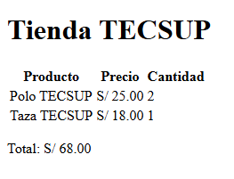
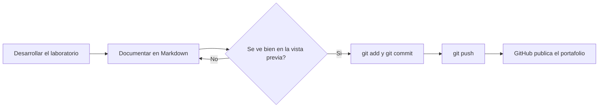

# Mi portafolio


Portafolio con la documentación de mis laboratorios del curso **Diseño de Interfaces de Programación Avanzado** de Tecsup.
Pensado para docentes y compañeros que quieran revisar mi avance, consultar la guía de cada proyecto
o reutilizar los comandos y plantillas en sus propios trabajos.

## Tabla de contenidos

- [Sobre mi](#sobre-mi)
- [Instalacion](#instalacion)
- [Uso](#uso)
- [Estructura del repositorio](#estructura-del-repositorio)
- [Trabajos del curso](#trabajos-del-curso)
- [Avance del modulo](#avance-del-modulo)
- [Flujo de trabajo](#flujo-de-trabajo)
- [Comandos que mas uso](#comandos-que-mas-uso)
- [Herramientas](#herramientas)
- [Contribucion](#contribucion)
- [Licencia](#licencia)
- [Autor](#autor)

## Sobre mi

Estudiante de Diseño y Desarrollo de Software en Tecsup. En este repositorio reúno lo que voy aprendiendo en el curso: control de versiones con Git, trabajo colaborativo en GitHub y documentación técnica con Markdown.

## Instalacion

Requisitos: Git y un editor con vista previa de Markdown. Se recomienda Visual Studio Code con las extensiones **Markdown Preview Mermaid Support** y **Markdown Checkboxes**.

```bash
git clone https://github.com/rodrigoxd711-tecsup/mi-portafolio.git
cd mi-portafolio
```

## Uso

1. Abre el proyecto en Visual Studio Code:

```powershell
code .
```

2. Abre `README.md` y presiona `Ctrl + K` y luego `V` para ver la vista previa al costado.
3. Entra a la guía de cada proyecto desde la tabla de [Trabajos del curso](#trabajos-del-curso).

Para agregar un nuevo trabajo, crea su guía en la carpeta `docs/` y agrega una fila a la tabla de trabajos:

```markdown
| Laboratorio 06 | Tema del laboratorio | Completado | [Guia](docs/LAB06.md) |
```

## Estructura del repositorio

```text
mi-portafolio/
├── docs/
│   └── GUIA.md          # Guia del proyecto Tienda TECSUP (Laboratorio 03)
├── img/
│   └── captura.png      # Evidencia del trabajo en GitHub
├── CONTRIBUTING.md      # Reglas para colaborar
├── LICENSE              # Licencia MIT
└── README.md            # Este documento
```

## Trabajos del curso

| Laboratorio | Tema | Estado | Documentacion |
|:------------|:-----|:------:|--------------:|
| Laboratorio 01 | Git básico | Completado | - |
| Laboratorio 03 | Trabajo colaborativo: Tienda TECSUP | Completado | [GUIA.md](docs/GUIA.md) |
| Laboratorio 04 | Fundamentos de Markdown | Completado | Este README |
| Laboratorio 05 | Markdown avanzado y README profesional | Completado | [app-notas](https://github.com/rodrigoxd711-tecsup/app-notas) |

### Evidencia



## Avance del modulo

- [x] Laboratorio 01: Git básico
- [x] Laboratorio 03: Trabajo colaborativo
- [x] Laboratorio 04: Fundamentos de Markdown
- [x] Laboratorio 05: Markdown avanzado y README profesional
- [ ] Agregar la guía de cada laboratorio en la carpeta `docs/`
- [ ] Publicar el portafolio con GitHub Pages

## Flujo de trabajo

Así documento cada laboratorio, desde el editor hasta GitHub:



## Comandos que mas uso

Para ver el estado del proyecto uso `git status`.

```bash
git add .
git commit -m "Actualiza el README"
git push origin main
```

| Comando | Que hace |
|:--------|:---------|
| `git status` | Muestra los archivos modificados |
| `git add` | Prepara los cambios |
| `git commit` | Guarda la versión |
|