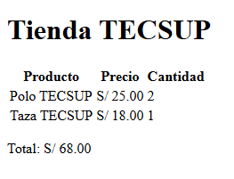

# Guía del proyecto Tienda Tecsup

En esta guía explico cómo descargar y probar la corrección que realicé en el laboratorio 03.

## Descripción del proyecto

El proyecto muestra una tienda con un carrito de compras. Mi trabajo consistió en corregir el cálculo del total para que considere la cantidad de cada producto.

### Objetivo de la corrección

Multiplicar el precio de cada producto por su cantidad antes de sumarlo al total del carrito.

## Herramientas necesarias

- Git para descargar el repositorio.
- Visual Studio Code para revisar los archivos.
- Un navegador web para abrir la página.

## Cómo descargar el proyecto

1. Abre una terminal en la carpeta donde guardarás el proyecto.
2. Ejecuta los siguientes comandos para descargar la rama que contiene mi corrección y abrirla en Visual Studio Code.

```powershell
git clone --branch fix-total-carrito https://github.com/rodrigoxd711-tecsup/tienda-tecsup.git tienda-tecsup-prueba
cd tienda-tecsup-prueba
code .
```

## Cómo probar el proyecto

1. Abre la carpeta descargada en el Explorador de archivos.
2. Abre el archivo `index.html` con tu navegador.
3. Comprueba el total del carrito: dos polos de S/ 25 y una taza de S/ 18 deben sumar S/ 68.

### Corrección aplicada

En `script.js`, multipliqué el precio de cada producto por su cantidad antes de acumularlo en el total:

```javascript
total = total + producto.precio * producto.cantidad;
```

## Archivos principales

| Archivo | Función |
|---------|---------|
| `index.html` | Contiene la estructura de la página. |
| `estilos.css` | Contiene los estilos visuales del proyecto. |
| `script.js` | Contiene la lógica y el cálculo del carrito. |


## Herramientas utilizadas

- **Visual Studio Code:** editor utilizado para revisar y modificar el código.
- **Git:** herramienta para controlar las versiones del proyecto.
- **GitHub:** plataforma donde se almacena el repositorio.

## Lista de tareas

- [x] Descargar y revisar el proyecto.
- [x] Identificar el error en el cálculo del carrito.
- [x] Corregir el archivo `script.js`.
- [x] Comprobar el cálculo del total de S/ 68.
- [ ] Publicar la guía del proyecto en GitHub.

## Evidencia del proyecto

La siguiente imagen muestra una captura del trabajo realizado durante el curso.



## Enlaces de referencia

- [Documentación de JavaScript - MDN](https://developer.mozilla.org/es/docs/Web/JavaScript)
